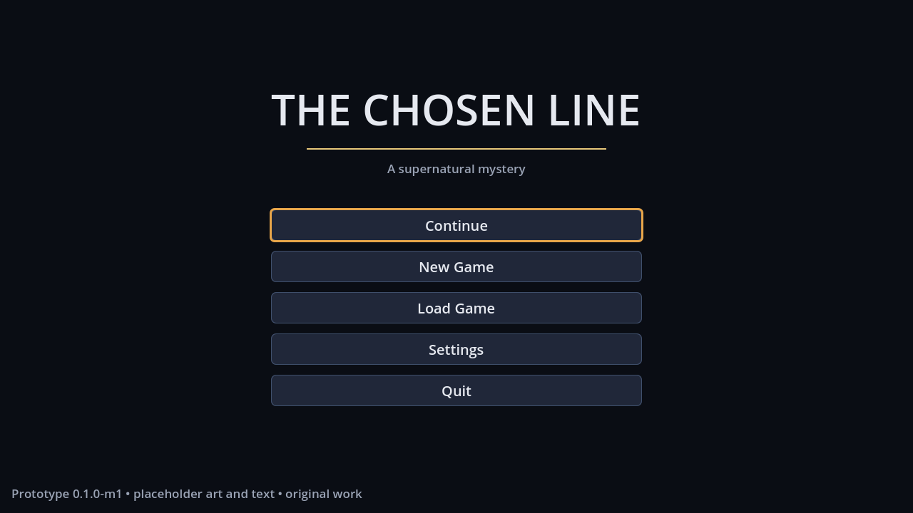
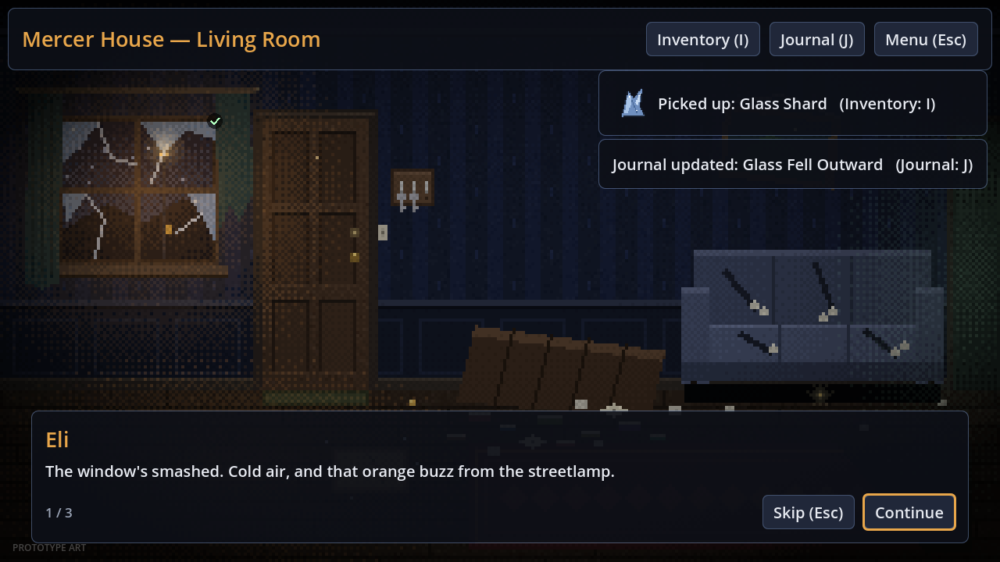
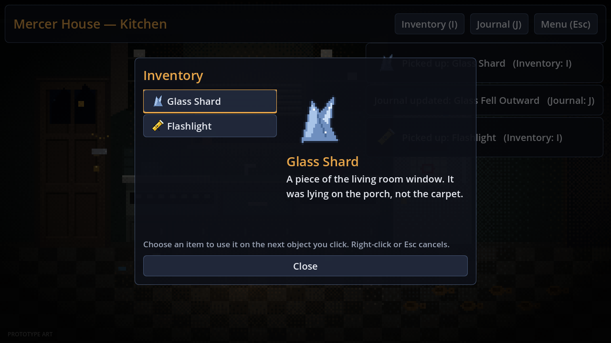
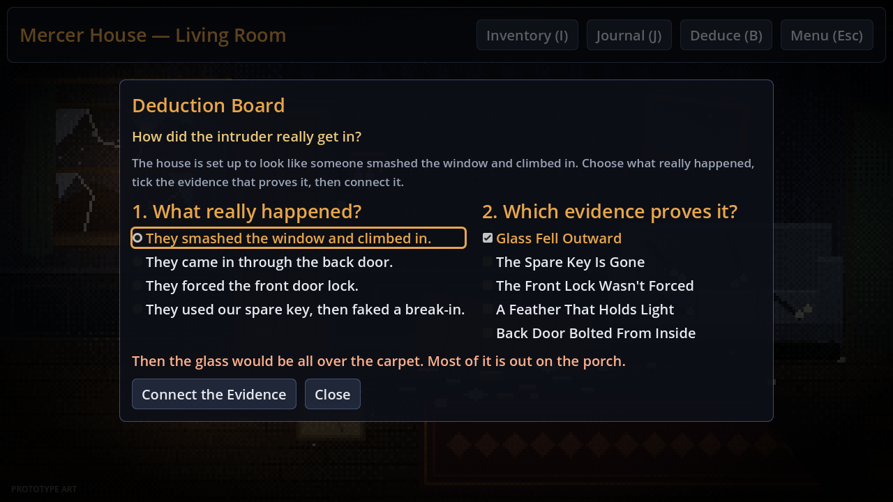

# The Chosen Line

An original 2D point-and-click supernatural mystery adventure, built in **Godot 4.3+ with GDScript**.
The Game Bible is the source of truth for story, art and audio direction. This repository is the
engineering build, developed in milestones.

**Current status: v0.2.0.** Chapter 1 (Eli's house) is playable from start to finish: you
search, deduce, and leave. All art and audio are original, generated by `tools/generate_art.py`
and `tools/generate_audio.py`. All story text is a draft.






## Download and play

Desktop builds for **Windows**, **macOS** (universal: Apple Silicon and Intel) and **Linux** are
produced by the *Test and build* GitHub Actions workflow on every push. Open the workflow run and
download the `TheChosenLine-builds` artifact. Pushing a tag such as `v0.2.0` also attaches the
three zips to a GitHub Release.

| Platform | How to start |
| --- | --- |
| Windows | Unzip and run `TheChosenLine.exe`. The build is unsigned, so SmartScreen may warn you: choose **More info → Run anyway**. |
| macOS | Unzip and move **The Chosen Line.app** to Applications. The app is ad-hoc signed but not notarized, so the first time, right-click it and choose **Open**. On macOS 15, use **System Settings → Privacy & Security → Open Anyway**. |
| Linux | Unzip, then run `./TheChosenLine.x86_64`. If the executable bit was lost, run `chmod +x TheChosenLine.x86_64` first. |

To build locally, install Godot 4.3 with its export templates, then run
`godot --headless --path . --export-release "Windows" build/windows/TheChosenLine.exe`
(or use `"Linux"` or `"macOS"`; the presets are in `export_presets.cfg`).

## How to run from source

1. Install [Godot 4.3 or newer](https://godotengine.org/download) (the standard build, not .NET).
2. Open Godot, click **Import**, and select this folder's `project.godot`.
3. Press **F5** (Run Project).

To run from the command line instead:

```sh
godot --path .            # play
godot --path . -e         # open the editor
```

No internet access, external services or AI APIs are used at runtime.

## Controls

| Action | Keys |
| --- | --- |
| Examine / confirm | Left-click, Enter or Space |
| Move between objects | Tab / Shift+Tab or arrow keys |
| Inventory | I |
| Journal | J |
| Deduction board | B |
| Highlight all objects (hold) | H (or turn on *Always highlight objects* in Settings) |
| Menu / cancel selected item | Esc (right-click also cancels an item) |
| Developer debug overlay | F3 |

To **use an item**, open the Inventory, choose the item, then click the object to use it on.

## Running the tests

```sh
godot --headless --path . --import                      # first run only: builds the import cache
godot --headless --path . res://tests/test_runner.tscn  # exit code 0 = all passed
```

The suite covers content validation, interaction rules, the deduction's hints and solution, the
chapter's critical path from start to ending, an exhaustive no-softlock exploration, audio assets, save/load (round trip, missing fields, stale IDs,
newer versions, corrupt files), settings persistence, and a UI smoke test of the title,
dialogue, overlays and room transitions. The manual checklist is in
[docs/TEST_CHECKLIST.md](docs/TEST_CHECKLIST.md).

## Project structure

| Path | Responsibility |
| --- | --- |
| `scenes/` | Title and game scenes (the UI is built in code by their scripts) |
| `scripts/core/` | Autoloads: `ContentDB` (load and validate data), `GameState`, `SaveSystem`, `Settings`, `SceneRouter`, `AudioManager`, plus input bindings |
| `scripts/interactions/` | `interaction_resolver.gd` (hotspot rules to state changes) and `deduction_logic.gd`, with no UI |
| `scripts/rooms/` | Room view (draws data-defined backdrops) and hotspot buttons |
| `scripts/ui/` | Theme, dialogue panel, inventory, journal, deduction board, chapter recap, pause, save/load, settings, debug overlay |
| `scripts/game/` | Game screen: wires the room view, HUD and menus to gameplay |
| `data/game.json` | Start room, objectives, chapters |
| `data/deductions/` | Deduction puzzles (answers, required proof, hints) |
| `data/rooms/` | Rooms, backdrops, hotspots and their interaction rules |
| `data/dialogue/` | Dialogue sequences |
| `data/items/`, `data/evidence/`, `data/characters/` | Items, evidence cards, speakers |
| `assets/art/backgrounds/`, `assets/art/items/` | Pixel-art rooms (320×180, shown at 4×) and item icons (32×32) |
| `tools/generate_art.py` | Regenerates all art (Python 3, Pillow, numpy) |
| `assets/audio/` | Room ambience, title music and sound effects (22 kHz mono WAV) |
| `tools/generate_audio.py` | Regenerates all audio (Python 3, numpy) |
| `export_presets.cfg`, `.github/workflows/build.yml` | Desktop export presets and the CI build |
| `tests/` | Headless test runner |
| `docs/` | Test checklist, asset manifest, screenshots |

### Architecture notes

- **Stable IDs everywhere** (`room_`, `hs_`, `item_`, `ev_`, `dlg_`). Content refers to content only by ID.
- **Data-driven content.** Adding a room, hotspot, clue or dialogue means editing JSON, not code.
- **Validated at startup.** `ContentDB` checks every reference, hotspot size, screen bounds, and
  that every hotspot gives feedback. It also flags typos in rule keys and flags that nothing sets,
  and warns about rooms that can't be reached. Errors name the file and ID and also appear on the
  title screen.
- **UI is separate from gameplay.** `GameState` and `InteractionResolver` have no UI references; the
  UI only listens to signals.
- **Versioned saves** (`user://saves/*.json`, `save_version: 1`): written atomically, migrated on
  load, and tolerant of missing fields and of IDs removed from content. There are three manual
  slots plus an autosave on every room entry.
- **Settings** persist to `user://settings.cfg` and apply immediately.

### Art pipeline

Backgrounds are drawn at 320×180 and displayed at 1280×720. One art pixel is 4 screen pixels,
so a hotspot `rect` divided by 4 gives its art coordinates. Rooms reference their image with
`backdrop.image`, and items reference theirs with `icon`. To change the art, edit
`tools/generate_art.py`, run `python3 tools/generate_art.py`, then refocus the Godot editor (or
run `godot --headless --path . --import`) so it reimports the PNGs. `backdrop.shapes` can still
block out a new room before its art exists. The rendering keeps the pixels crisp with nearest
filtering, ordered-dither lighting (sodium-orange streetlight, cold kitchen light) and a faint
gold glint under the couch that hints at the feather.

### Audio

All audio is synthesized by `tools/generate_audio.py`, so there are no samples.
- **Ambience:** traffic rumble, wind through the broken window and the fridge hum in the house; a
  louder hum, compressor buzz and a ticking clock in the kitchen.
- **Title music:** a sparse D-minor piano loop over a low drone.
- **Effects:** pickup chime, pencil scratches for new evidence, footsteps and door, the distant
  church bell, a choir-like "revelation" pad and a soft "wrong" tone.

Rooms choose a loop with `"ambience"`. A rule can play a sound with
`{"type": "play_sound", "id": "bell"}`, which plays `assets/audio/sfx/bell.wav`. Loops crossfade
on the Music and Ambience buses, so the Settings volume sliders control them.

### Deductions (data/deductions)

A deduction has a question, answers (each wrong one with a `rebuttal`), the `correct_answer`, the
`required_evidence` the player must connect, optional supporting evidence, and hints for missing,
irrelevant or not-yet-found proof. Solving one sets `solved_<id>`, runs its `effects` and plays its
`success_dialogue`. Wrong attempts cost nothing, so the puzzle can't softlock.

### Interaction rules (data/rooms)

Each hotspot has an ordered `interactions` list, and the first rule whose conditions match runs:

```json
{
  "use_item": "item_flashlight",
  "requires_absent_flags": ["got_gold_feather"],
  "dialogue": "dlg_find_feather",
  "lines": [{ "speaker": "eli", "text": "..." }],
  "effects": [
    { "type": "give_item", "id": "item_gold_feather" },
    { "type": "add_evidence", "id": "ev_unearthly_feather" },
    { "type": "set_flag", "id": "got_gold_feather" }
  ]
}
```

The available conditions are `use_item`, `requires_flags` / `requires_absent_flags`,
`requires_items` / `requires_absent_items`, and `requires_evidence` / `requires_absent_evidence`.
The available effects are `give_item`, `remove_item`, `add_evidence`, `set_flag`, `goto_room`,
`play_sound` and `end_chapter` (which shows the chapter recap from `data/game.json`).
Every interaction also sets `seen_<hotspot_id>`.

## Status report (v0.2.0)

**What's playable**

- Chapter 1 runs from start to finish in Eli Mercer's ransacked home (a living room with
  8 hotspots and a kitchen with 5).
- Four collectable items with pixel-art icons and six evidence cards, plus a flashlight puzzle
  that spans both rooms.
- **Deduction board (B):** prove how the intruder really got in. Wrong answers get an in-world
  rebuttal, and missing or irrelevant proof gets a hint. Solving it opens the front door.
- **Chapter ending:** leaving the house ends Chapter 1 with a recap card listing the evidence found,
  playtime and what comes next, as the Bible asks for before major beats.
- Original audio: room ambience, title music and sound effects on the volume-controlled buses.
- Mouse and full keyboard play, dialogue with Skip, inventory, journal with the current
  objective, three save slots plus an autosave, settings for accessibility and audio, and an F3
  debug overlay.
- Windows, macOS and Linux export presets, and a CI workflow that tests and builds all three.

**Tests performed**

- The headless suite: 130 checks, all passing on Godot 4.3.
- Rendered the game under a virtual display to check the new screens.
- Exported all three platforms. The Linux build launched and loaded all content with 0 errors.
- The Windows and macOS builds exported cleanly but have not been launched on real hardware yet.

**Known issues / limits**

- Prototype pixel art (no characters or animation yet) and draft story text. Family details must
  be checked against the Bible's character sections.
- Builds are unsigned (Windows) or ad-hoc signed and not notarized (macOS), so each OS shows a
  first-launch warning. The Windows `.exe` uses Godot's default file icon, because `rcedit` was not
  available when exporting.
- The subtitles toggle is stored but has no effect until voiced lines exist (all text is always
  shown).
- Dialogue is linear; choice trees are Milestone 3. Key remapping is not exposed in the UI yet.

**Next steps**

- Milestone 3: a dialogue tree with meaningful choices and persistent flags.
- Chapter 1 proper: the neighborhood and school locations, with Eli and other characters on
  screen.
